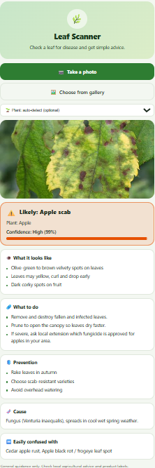
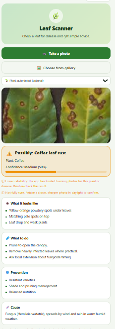
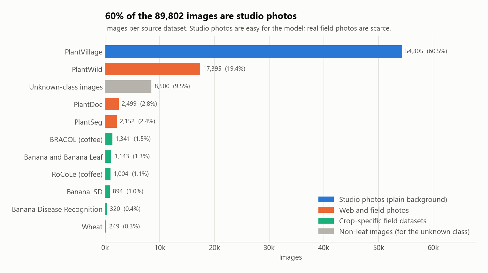
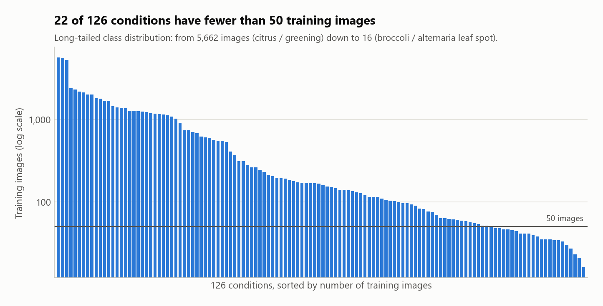
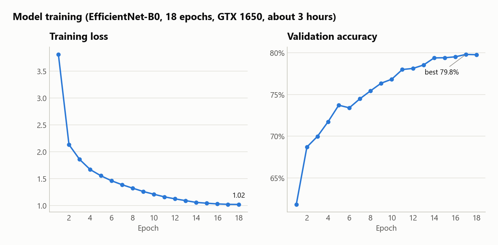
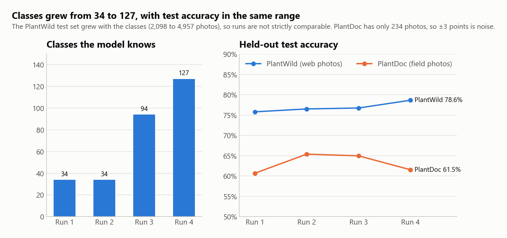
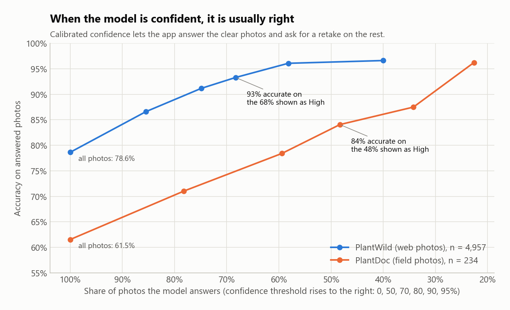
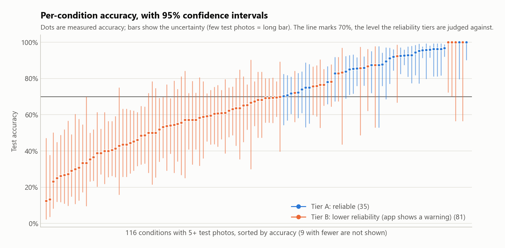
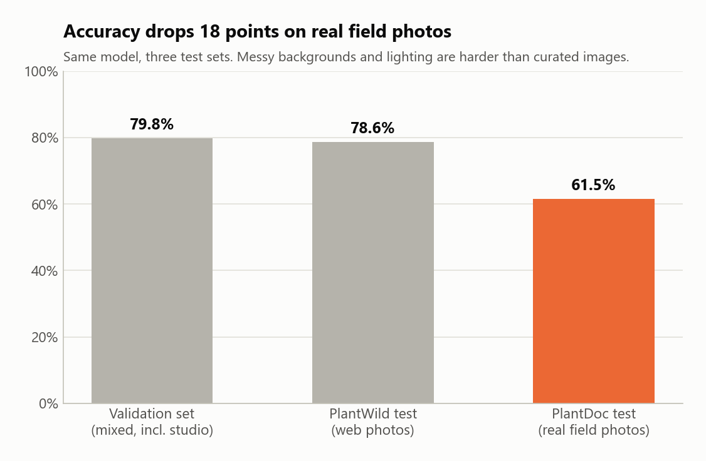

# Leaf Scanner: plant disease detection on your phone

Take a photo of a leaf and Leaf Scanner tells you which plant it is, whether it shows signs of a disease, and what you can do about it. It runs fully offline on an Android phone, and the same model also runs as a small web app.

The app covers **34 plants and 126 conditions** (95 diseases and 31 healthy-leaf classes). It also recognises leaves and photos it does not know, and it is available in **English, Hindi (हिन्दी) and Marathi (मराठी)**.

<p align="center">
  
  &nbsp;&nbsp;
  
</p>
<p align="center"><sub>Left: a confident result. Right: a medium-confidence result, where the app warns and asks for a clearer photo.</sub></p>

---

## Features

- **Scan with the camera or pick from the gallery.** The app shows one clear result: the condition, the plant and a confidence level (High / Medium / Low).
- **Practical advice** for each condition: what it looks like, what to do, how to prevent it and what causes it. It also lists lookalike diseases that are easy to confuse with it.
- **Honest about uncertainty:**
  - Low-confidence results ask you to retake a clearer photo.
  - Each condition has a reliability tier set from its measured test accuracy (see [Reliability tiers](#reliability-tiers)). Conditions that tested weak show a warning.
  - Leaves from plants the app does not know get *"Not sure what type of leaf this is"* instead of a made-up answer.
  - A leaf that clearly looks diseased but matches no disease the app can name gets *"Looks diseased, disease not identified"* with advice to show it to an agriculture officer.
  - For plants where the app only knows the healthy leaf (for example raspberry), it says *"Looks healthy (disease not checked)"*.
- **Optional plant picker.** If you already know the plant, choose it, and the app only considers that plant's conditions.
- **Three languages.** English, Hindi and Marathi, using common local disease names (for example भुरी, केवडा, तांबेरा, करपा).
- **Works offline.** The model runs on the phone. Photos are never uploaded.
- **Scan history and feedback.** Mark each result right or wrong, which helps decide what to improve next.

---

## How it works

```
Photo ──► resize 256 / centre-crop 224 ──► EfficientNet-B0 (+ flipped copy) ──► calibrated softmax ──► result + advice
```

- **Model:** EfficientNet-B0 pretrained on ImageNet and fine-tuned on about 80k training images (127 classes: 126 conditions plus one "unknown" class).
- **Training:**
  - AdamW optimiser with a one-cycle learning-rate schedule and label smoothing.
  - Mixed precision.
  - A weighted sampler that gives more weight to real field photos and balances rare classes.
- **Calibration:** temperature scaling on the validation set, so that confidence numbers mean something.
- **On the phone:**
  - The model is exported to ONNX and runs with ONNX Runtime inside a Flutter app.
  - Image preprocessing is re-implemented in Dart to match the Python pipeline exactly. A test checks this against Python output.
- **Advice:** comes from a hand-written knowledge base keyed by class. It is never generated on the fly.

---

## Results

All numbers are on held-out photos the model never saw during training. PlantVillage (studio photos) is used for training only, because accuracy on it says little about real use.

| Test set | Photos | Accuracy |
|---|---|---|
| PlantDoc test split (real field photos) | 234 | **61.5%** (63.2% with the flip-averaging the app uses) |
| PlantWild held-out slice (web photos, noisy labels) | 4,957 | **78.6%** |

The previous version (33 plants) scored 65.0% on PlantDoc and 76.7% on PlantWild. On the 234 field photos the difference is 3 photos, which is within noise, while the model now covers about 30 more conditions.

Accuracy is much higher when the model is confident:

| Shown confidence | Share of PlantDoc photos | Accuracy on those | Share of PlantWild photos | Accuracy on those |
|---|---|---|---|---|
| ≥ 80% (High) | 48% | 84% | 68% | 93% |
| ≥ 90% | 34% | 88% | 58% | 96% |

That is why the app always shows the confidence level and asks for a retake when it is low.

Some web photos in the training data also appear in public image collections, so a photo you find online may be one the model has already seen. Test on your own photos of real leaves to see honest results.

### Reliability tiers

Each condition is rated from how it did on held-out test photos:

| Tier | Meaning | Conditions |
|---|---|---|
| A | Tested accurately (at least 15 test photos and a 95% lower bound of 70% or more), or trained on real photos from two datasets and not measured weak | 36 |
| B | Weak or unproven in tests: few test photos, or accuracy under 70%. The app shows a "lower reliability" note | 87 |
| C | Studio photos only, never checked on field photos | 3 |

Several common conditions, such as tomato, apple, corn and potato diseases, are in tier B because they look alike and scored under 70% in tests, even though they have plenty of training photos.

The full list of plants and conditions with their tiers is in [list.txt](list.txt).

---

## Data analysis

All charts are generated by [scripts/make_charts.py](scripts/make_charts.py) from the dataset manifest, the training log and the test reports of all four training runs. Those inputs are too large or too old to keep in this repository, so the script needs the local `data/` and `models_run*/` folders to run. Each chart has a light and a dark version, and GitHub shows the one that matches your theme.

### 1. The data is mostly studio photos

<picture>
  <source media="(prefers-color-scheme: dark)" srcset="docs/charts/01_dataset_composition_dark.png">
  
</picture>

**Finding:** 60% of the images are PlantVillage studio photos: single leaves on a plain background. Real field photos (PlantDoc, PlantSeg and the crop-specific sets) are under 12%. A model trained on this mix can look good in the lab and still struggle in a farmer's field, so the training sampler gives field photos 8× more weight.

### 2. Many conditions have very little data

<picture>
  <source media="(prefers-color-scheme: dark)" srcset="docs/charts/02_class_imbalance_dark.png">
  
</picture>

**Finding:** the class distribution is long-tailed, from 5,662 images for the largest class down to 16 for the smallest. 22 conditions have fewer than 50 training images. Class-balanced sampling helps, but these conditions also have very few test photos, which is why their accuracy is uncertain (chart 6).

### 3. Training converged smoothly

<picture>
  <source media="(prefers-color-scheme: dark)" srcset="docs/charts/03_training_curves_dark.png">
  
</picture>

**Finding:** validation accuracy rises steadily and flattens at about 80% by epoch 17, and it never drops, so the model is not overfitting the training set. More epochs would add little; better field data would help more.

### 4. The model grew without losing accuracy

<picture>
  <source media="(prefers-color-scheme: dark)" srcset="docs/charts/04_model_evolution_dark.png">
  
</picture>

**Finding:** across four training runs the model went from 34 to 127 classes, almost four times as many, while accuracy stayed in the same range. The PlantDoc changes (61% to 65% and back) are within the noise of a 234-photo test set.

### 5. Confidence is trustworthy

<picture>
  <source media="(prefers-color-scheme: dark)" srcset="docs/charts/05_confidence_vs_accuracy_dark.png">
  
</picture>

**Finding:** this is the most important chart for the product. Accuracy rises steadily as the confidence threshold rises, which means the calibrated confidence can be trusted. On field photos the app is right 84% of the time when it says "High", against 61.5% overall. So the app shows confidence on every result and asks for a retake when it is low, instead of hiding uncertainty.

### 6. Per-condition accuracy, with honest error bars

<picture>
  <source media="(prefers-color-scheme: dark)" srcset="docs/charts/06_per_class_accuracy_dark.png">
  
</picture>

**Finding:** a single accuracy number per class can mislead. A condition at 100% on 5 test photos is far less certain than one at 90% on 80 photos. The 95% Wilson intervals make this visible, and they are what the [reliability tiers](#reliability-tiers) are built on, so the app warns on any condition that has not proven itself.

### 7. Field photos are the real test

<picture>
  <source media="(prefers-color-scheme: dark)" srcset="docs/charts/07_lab_vs_field_dark.png">
  
</picture>

**Finding:** the same model scores 79.8% on the validation set but 61.5% on real field photos, a gap of 18 points. This is distribution shift: messy backgrounds, lighting and several leaves per photo. It is why this README reports field accuracy as the headline number rather than the validation score.

---

## Project structure

```
app/                 Web app (FastAPI server + single-page UI) and knowledge base
  server.py          Runs the model, serves the page on port 8000
  index.html         Browser UI (camera, plant picker, language switch)
  knowledge_*.json   Advice per condition (English, Hindi, Marathi)
mobile_app/          Flutter Android app (offline, ONNX Runtime)
  lib/               Screens, classifier, preprocessing, translations
  assets/            model.onnx, classes, knowledge base, UI strings
scripts/             Data preparation, training, evaluation and export
  build_dataset.py   Merges the datasets into one label scheme and splits
  train.py           Training + calibration + test report
  export_onnx.py     Exports the model and checks ONNX vs PyTorch outputs
  build_i18n.py      Builds the Hindi/Marathi knowledge files
  make_charts.py     Builds the analysis charts in docs/charts
docs/                Charts and app screenshots for this README
i18n/                Translation sources (edit the text after "|")
models_run4/         Final model weights, classes and test report
DATASETS.md          Dataset choices and split rules
list.txt             Supported plants and conditions
```

---

## Running it

### Web app (any phone on the same Wi-Fi)

```bash
python -m venv .venv
.venv\Scripts\activate          # Windows
pip install torch==2.5.1 torchvision==0.20.1 --index-url https://download.pytorch.org/whl/cu121
pip install -r requirements.txt

python app/server.py
```

Open `http://localhost:8000` on the PC, or `http://<PC-IP>:8000` on a phone connected to the same Wi-Fi.

### Android app

Download `LeafScanner.apk` from the Releases page and install it on the phone (allow "Install unknown apps"), or build it yourself:

```bash
cd mobile_app
flutter pub get
flutter build apk --release
```

### Retraining

```bash
python scripts/build_dataset.py                       # builds data/processed2 from the first datasets
python scripts/build_dataset3.py                      # adds PlantSeg, banana, coffee and wheat data -> data/processed3
python scripts/train.py --data data/processed3 --out models_run4 --epochs 18 --samples 40000 --field_weight 8 --balance 0.5
python scripts/assign_tiers.py models_run4 data/processed3   # reliability tiers from measured accuracy
python scripts/export_onnx.py models_run4 data/processed3
python scripts/merge_kb.py
python scripts/build_i18n.py
python scripts/make_charts.py                         # regenerates the README charts (needs matplotlib, pandas)
```

On a GTX 1650, training takes about 3 hours.

---

## Limitations

- **This is a decision aid, not a diagnosis.** Check with a local agriculture officer before treating plants.
- Many diseases are still missing, for example raspberry diseases, carrot Cercospora leaf blight, cauliflower black rot and most diseases of tomato lookalikes. Many new classes have under 50 photos and only a handful of test photos, so their accuracy is uncertain. A leaf with a disease the model does not know may come out as the closest condition it knows, as "diseased, not identified", or sometimes as "healthy".
- Fruit and ear diseases are not covered; the app is for leaves.
- Field accuracy is limited by noisy web labels in PlantWild and by diseases that look alike.
- The Hindi and Marathi text has not yet been reviewed by a native speaker. English is the reference.

---

## Datasets and credits

- **PlantVillage**, Hughes & Salathé. [huggingface.co/datasets/mohanty/PlantVillage](https://huggingface.co/datasets/mohanty/PlantVillage). CC BY-SA 3.0.
- **PlantDoc**, Singh et al., 2020. [github.com/pratikkayal/PlantDoc-Dataset](https://github.com/pratikkayal/PlantDoc-Dataset). CC BY 4.0.
- **PlantWild**, Wei et al., 2024. [huggingface.co/datasets/Voxel51/PlantWild](https://huggingface.co/datasets/Voxel51/PlantWild). CC BY-NC-ND 4.0.
- **PlantSeg**, Wei et al., 2025. [zenodo.org/records/17719108](https://zenodo.org/records/17719108), [github.com/tqwei05/PlantSeg](https://github.com/tqwei05/PlantSeg). CC BY-NC 4.0.
- **Banana:** [BananaLSD](https://data.mendeley.com/datasets/9tb7k297ff), [Banana Disease Recognition Dataset](https://data.mendeley.com/datasets/79w2n6b4kf), [Banana and Banana Leaf Dataset](https://data.mendeley.com/datasets/5nfjzntwd8). Mendeley Data, CC BY 4.0.
- **Coffee:** [BRACOL](https://data.mendeley.com/datasets/yy2k5y8mxg) (Brazilian Arabica coffee leaves) and [RoCoLe](https://data.mendeley.com/datasets/c5yvn32dzg) (Robusta coffee leaves, Parraga-Alava et al.). Mendeley Data, CC BY 4.0.
- **Wheat (healthy leaves):** [Disease Dataset of Wheat](https://data.mendeley.com/datasets/5gc7hwydwg). Mendeley Data, CC BY 4.0.
- **Unknown-class images** come from Caltech-101, the Describable Textures Dataset and Oxford 102 Flowers.

This project is for learning and portfolio purposes only and is **not for commercial use**, because some of the training datasets (PlantWild, PlantSeg) have non-commercial licenses.

## License

The source code is released under the [MIT License](LICENSE).

The trained model weights (`models_run4/`, `mobile_app/assets/model.onnx`) were trained on data that includes PlantWild (CC BY-NC-ND 4.0) and PlantSeg (CC BY-NC 4.0), so the model is for non-commercial use only. The datasets keep their own licenses, listed above.
